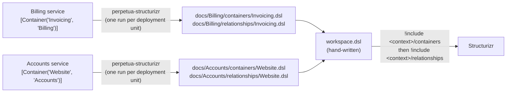

# Perpetua

[](https://github.com/SebaVDP/Perpetua/actions/workflows/ci.yml)
[](https://www.nuget.org/packages/Perpetua)
[](https://www.nuget.org/packages/Perpetua.Structurizr)
[](LICENSE)

Perpetua is a living-documentation platform: embed meaningful markers in your code and generate always-current documentation (C4/Structurizr, flows, onboarding).

## Install

```bash
dotnet add package Perpetua
dotnet tool install --global Perpetua.Structurizr
```

## Usage

### How it fits together



Each deployment unit is documented by its own run. The hand-written workspace brings the generated folders together.

### Example

Two deployment units, each marking its entry point with the container it represents:

```csharp
// Billing service
[Container("Invoicing", "Billing")]
public class InvoicingService { }

// Accounts service
[Container("Website", "Accounts")]
public class WebsiteHost { }
```

Every attribute names the container first and its context after it: `[Container(name, context)]`, `[DependsOn(name, context)]` and `[Consumes(eventName, publisher, context)]`.

A container declares the other containers it depends on with `[DependsOn]`, on any class of the same deployment unit:

```csharp
// Billing service
[DependsOn("Website", "Accounts", "Looks up customers")]
public class CustomerLookup { }

[DependsOn("Ledger")]
public class PostingJob { }
```

`[DependsOn(name, context = null, description = null)]`:

- The name of the target container is required.
- The context is optional and defaults to the context of the container of the deployment unit (`Billing` here, so `Ledger` is `Billing.Ledger`).
- The description is optional and becomes the description of the relationship.

Run the tool once per deployment unit, passing the directory with its assemblies and, optionally, the output directory (both default to the current directory):

```bash
perpetua-structurizr ./billing/bin/Release/net10.0 ./docs
perpetua-structurizr ./accounts/bin/Release/net10.0 ./docs
```

The output directory now contains one folder per context:

```
docs/
├── Billing/
│   ├── containers/
│   │   └── Invoicing.dsl      Invoicing = container "Invoicing"
│   └── relationships/
│       └── Invoicing.dsl      Billing.Invoicing -> Accounts.Website "Looks up customers"
│                              Billing.Invoicing -> Billing.Ledger
└── Accounts/
    ├── containers/
    │   └── Website.dsl        Website = container "Website"
    └── relationships/
        └── Website.dsl        (empty: no dependencies declared)
```

Include the folders in a hand-written workspace. It uses `!identifiers hierarchical`, and the context must equal the identifier of the `softwareSystem` that includes its folder:

```
workspace {
    !identifiers hierarchical
    model {
        Billing = softwareSystem "Billing" {
            !include docs/Billing/containers
        }
        Accounts = softwareSystem "Accounts" {
            !include docs/Accounts/containers
        }
        !include docs/Billing/relationships
        !include docs/Accounts/relationships
    }
}
```

Include every `containers` folder first, then every `relationships` folder. A relationship can point to a container of another context, so all containers must be declared before any relationship is read.

Separate runs can therefore declare containers with the same name in different contexts.

### Events

A container publishes an event with `[Event]`, on any class of its deployment unit. Another container consumes it with `[Consumes]`:

```csharp
// Billing service (container Invoicing, context Billing)
[Event("InvoiceIssued")]
public class InvoicingService { }

// Accounts service (container Website, context Accounts)
[Consumes("InvoiceIssued", "Invoicing", "Billing")]
public class InvoiceInbox { }
```

`[Consumes(eventName, publisher, context = null, description = null)]`:

- The event name and the name of the publishing container are required.
- The context is the context of the publisher. It is optional and defaults to the context of the consumer.
- The description is optional and becomes the description of the relationship.

Every published event becomes a container of its own, named `<Container>_<Event>` and tagged `Event`, so two containers can publish an event with the same name. The consumer never writes that name; Perpetua derives it from the publisher and the event.

```
docs/
├── Billing/
│   ├── containers/
│   │   └── Invoicing.dsl       Invoicing = container "Invoicing"
│   │                           Invoicing_InvoiceIssued = container "Invoicing_InvoiceIssued" "" "" "Event"
│   └── relationships/
│       └── Invoicing.dsl       Billing.Invoicing -> Billing.Invoicing_InvoiceIssued
└── Accounts/
    ├── containers/
    │   └── Website.dsl         Website = container "Website"
    └── relationships/
        └── Website.dsl         Accounts.Website -> Billing.Invoicing_InvoiceIssued
```

Both relationships point to the event, so the publisher and the consumer never depend on each other directly. Style the `Event` tag once in your hand-written workspace, for example with a dashed border:

```
views {
    styles {
        element "Event" {
            border dashed
        }
    }
}
```

### Rules

- A deployment unit declares **one** container. More than one fails the run and generates nothing; none generates nothing and succeeds.
- A **valid identifier** is one or more of the characters `A-Z`, `a-z`, `0-9`, `_` and `-`, and does not start with `-`. So `Invoice-Api` and `Invoice_Api2` are valid, while `Invoice.Api`, `Invoice Api`, `Invoicé` and the empty string are not. Context, container name, dependency name and context, event name and the publisher and event name of a `[Consumes]` must all be valid identifiers, because they become a folder or a Structurizr identifier. Anything else fails the run.
- A relationship is identified by its target, its context and its description. Declaring the same one twice fails the run, so remove the duplicate. The same target with a different description is allowed, and so is the same container in two contexts.
- A deployment unit may publish an event name only once. The same event name in different deployment units is fine.
- Files from an earlier run with the same context and name are overwritten.

### Failures

A failed run generates nothing and exits with code `1` (success is `0`). It reports every problem it found, one per line, as a code and a message that names the offending value and the class that declares it, for example:

```
PSTRUCT.0004: Dependency name 'Payment.Gateway' on class 'Billing.PaymentClient' is not a valid identifier.
```

Here `Payment.Gateway` contains a `.`, which a valid identifier cannot (see [Rules](#rules)).

| Code | Problem |
|------|---------|
| `PSTRUCT.0001` | A deployment unit declares more than one container. |
| `PSTRUCT.0002` | The container name is not a valid identifier. |
| `PSTRUCT.0003` | The context is not a valid identifier. |
| `PSTRUCT.0004` | A dependency name is not a valid identifier. |
| `PSTRUCT.0005` | A dependency context is not a valid identifier. |
| `PSTRUCT.0006` | A dependency is declared twice with the same context and description. |
| `PSTRUCT.0007` | The same event is published twice in one deployment unit. |
| `PSTRUCT.0008` | An event name is not a valid identifier. |
| `PSTRUCT.0009` | The event named by a `[Consumes]` is not a valid identifier. |
| `PSTRUCT.0010` | The publisher named by a `[Consumes]` is not a valid identifier. |

What a valid identifier looks like is described in [Rules](#rules).

## License

[MIT](LICENSE)
