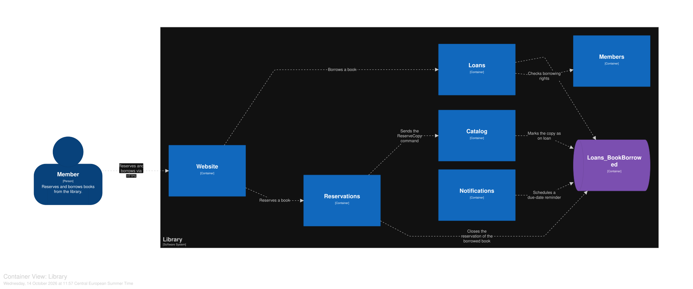

# Perpetua

[](https://github.com/SebaVDP/Perpetua/actions/workflows/ci.yml)
[](https://www.nuget.org/packages/Perpetua)
[](https://www.nuget.org/packages/Perpetua.Structurizr)
[](LICENSE)

Architecture diagrams drift. Someone draws them once, the code moves on, and nobody trusts them anymore.

Perpetua generates architecture diagrams from explicit markers in your C# code. Keep architectural intent close to the implementation, and regenerate the diagrams instead of maintaining them separately. The markers declare which container a service represents, what it depends on and which events it publishes or consumes. Perpetua reads them from your compiled assemblies and generates [Structurizr](https://structurizr.com) fragments.

The diagrams reflect those declarations. Perpetua does not verify that they match the implementation, so the markers still need to be maintained as the code changes.



The diagram above is the [Library sample](samples/Library/README.md): six deployment units whose containers, dependencies and `BookBorrowed` event all come from attributes. Only the workspace that includes the generated fragments is written by hand. The [legend](docs/images/library-containers-key.svg) explains the notation.
## Install

```bash
dotnet add package Perpetua
dotnet tool install --global Perpetua.Structurizr
```

## Quick start

Mark your service and what it depends on:

```csharp
[Container("Loans", "Library")]
public class Program { }

[DependsOn("Members", description: "Checks borrowing rights")]
public class MembersClient { }
```

Generate the fragments from the build output of each deployment unit:

```bash
perpetua-structurizr ./loans/bin/Release/net10.0 ./docs
```

Include the generated folders in your hand-written Structurizr workspace, and the relationship `Library.Loans -> Library.Members` appears in your diagram.

## Learn more

- [Concepts](docs/concepts.md): the words Perpetua uses and how a run turns markers into Structurizr fragments.
- [Attributes](docs/attributes.md): `[Container]`, `[DependsOn]`, `[Publishes]`, `[Consumes]` and the rules they follow, including [migration from the previous API](docs/attributes.md#breaking-api-changes).
- [Failures](docs/failures.md): the exit code and the `PSTRUCT` problem codes.
- [Library sample](samples/Library/README.md): a complete system with six deployment units, whose diagram is generated from its attributes.

## License

[MIT](LICENSE)
