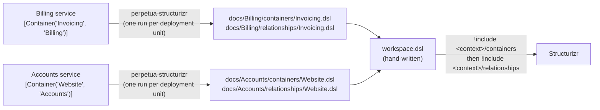

# Concepts

## The words Perpetua uses

- **Context:** the software system a container belongs to. It matches the C4 *software system*, and in Structurizr it is the `softwareSystem` that includes the container.
- **Container:** a separately running part of a context, such as a service or a website. It matches the C4 *container*. Its name identifies it within its context.
- **Deployment unit:** the code you build and deploy as one piece, for example a service. A deployment unit represents exactly one container and is documented by its own run.
- **Event:** something a container publishes that other containers can consume. Perpetua turns each event into a container of its own.
- **Marker:** an attribute you place on a class to say something about the architecture. See [Attributes](attributes.md).

## How a run works



Each deployment unit is documented by its own run. The hand-written workspace brings the generated folders together.

1. You run `perpetua-structurizr` once per deployment unit and pass it the directory with the built assemblies and, optionally, the output directory (both default to the current directory):

   ```bash
   perpetua-structurizr ./billing/bin/Release/net10.0 ./docs
   perpetua-structurizr ./accounts/bin/Release/net10.0 ./docs
   ```

2. The tool reads the markers from the assemblies, without loading their types, so classes that derive from types of a framework it does not have, such as an ASP.NET Core controller, are found too.
3. It checks the declarations against the [rules](attributes.md#rules). When something is wrong, the run fails, generates nothing and reports every problem. See [Failures](failures.md).
4. Otherwise it writes one folder per context, with a `containers` and a `relationships` folder, each holding one file per container:

   ```
   docs/
   ├── Billing/
   │   ├── containers/
   │   │   └── Invoicing.dsl      Invoicing = container "Invoicing"
   │   └── relationships/
   │       └── Invoicing.dsl      Billing.Invoicing -> Accounts.Website "Looks up customers"
   │                              Billing.Invoicing -> Billing.Ledger
   └── Accounts/
       ├── containers/
       │   └── Website.dsl        Website = container "Website"
       └── relationships/
           └── Website.dsl        (empty: no dependencies declared)
   ```

   Files from an earlier run with the same context and name are overwritten.

## The hand-written workspace

Perpetua does not generate `workspace.dsl`: the people, the views and the styles are yours. The workspace uses `!identifiers hierarchical`, and the context must equal the identifier of the `softwareSystem` that includes its folder:

```
workspace {
    !identifiers hierarchical
    model {
        Billing = softwareSystem "Billing" {
            !include docs/Billing/containers
        }
        Accounts = softwareSystem "Accounts" {
            !include docs/Accounts/containers
        }
        !include docs/Billing/relationships
        !include docs/Accounts/relationships
    }
}
```

Include every `containers` folder first, then every `relationships` folder. A relationship can point to a container of another context, so all containers must be declared before any relationship is read.

Separate runs can therefore declare containers with the same name in different contexts.

## Events

Every event a container publishes becomes a container of its own, named `<Container>_<Event>` and tagged `Event`. The publisher and every consumer get a relationship to it, so they never depend on each other directly:

```
docs/
├── Billing/
│   ├── containers/
│   │   └── Invoicing.dsl       Invoicing = container "Invoicing"
│   │                           Invoicing_InvoiceIssued = container "Invoicing_InvoiceIssued" "" "" "Event"
│   └── relationships/
│       └── Invoicing.dsl       Billing.Invoicing -> Billing.Invoicing_InvoiceIssued
└── Accounts/
    ├── containers/
    │   └── Website.dsl         Website = container "Website"
    └── relationships/
        └── Website.dsl         Accounts.Website -> Billing.Invoicing_InvoiceIssued
```

Style the `Event` tag once in your hand-written workspace, for example with a dashed border:

```
views {
    styles {
        element "Event" {
            border dashed
        }
    }
}
```
